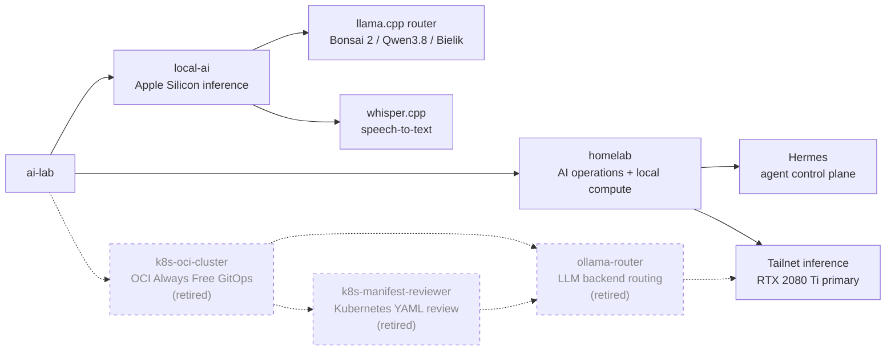

# AI Lab

A working repository for AI-assisted engineering across DevOps, Kubernetes, homelab automation, and LLM-powered tools.

The repo is built around real systems rather than isolated demos: a Tailscale-connected homelab with Hermes as its agent control plane, local GPU inference on Windows rigs, local Apple Silicon inference for 27B-class models and speech-to-text, and a Terraform/GitOps Kubernetes setup that ran a public LLM-backed demo until it was retired. The [homelab/](homelab/) directory is the meta view: current architecture plus a public-safe changelog of infrastructure changes.

## Repo Map

## AI-assisted engineering

This repo started with Claude Code, then moved to OpenAI Codex after practical comparison in daily use. Codex is now the main coding and operations assistant, and `gpt-5.6-sol` through Codex OAuth is the default model behind Hermes. The earlier `opus-expert` advisory endpoint (Claude behind an OpenAI-compatible API, wired into OpenClaw) was retired together with OpenClaw in 2026-10.

The human part is still the important part: architecture, requirements, tradeoffs, operations, and review. AI makes the implementation loop faster, but the work is grounded in infrastructure that actually runs.

## Start Here

| Area | Status | What to inspect |
|---------|--------|-------------|
| [homelab](homelab/) | Active | Current AI operations architecture, Tailscale-connected Windows GPU rigs, Rigwarden wake/status control under Hermes, and the public changelog showing how the lab evolved. |
| [local-ai](local-ai/) | Active | Local inference on a MacBook Pro (M5 Pro, 48 GB): PrismML's `llama.cpp` fork in router mode serving Ternary Bonsai 2 27B, Qwen3.8 27B and Bielik 11B behind one OpenAI-compatible endpoint, plus whisper.cpp transcription. Pinned, hash-checked setup from Homebrew; interleaved speed benchmarks, a sandboxed 15-task quality eval, and WER scoring against human captions. |
| [k8s-oci-cluster](k8s-oci-cluster/) | Retired 2026-10 | Terraform-managed OCI Always Free Kubernetes cluster with nginx ingress, external-dns, cert-manager and Argo CD GitOps. The cluster is torn down; the config is kept as a working reference that can rebuild it. |
| [ollama-router](https://github.com/maslankalm/ollama-router) | Retired 2026-10 | Standalone OpenAI-compatible FastAPI router for Ollama backends, which ran in-cluster with a Tailscale sidecar to reach the local GPU rigs. App code and GHCR image live in the separate public repository; deployment manifests stay under `k8s-oci-cluster/apps/ollama-router`. |
| [k8s-manifest-reviewer](https://github.com/maslankalm/k8s-manifest-reviewer) | Retired 2026-10 | Former public demo that reviewed Kubernetes YAML with `gpt-oss:20b` on a local RTX 2080 Ti through `ollama-router`, with Ollama Cloud free-tier fallback. Offline since the cluster was retired; manifests stay under `k8s-oci-cluster/apps/k8s-manifest-reviewer`. |
