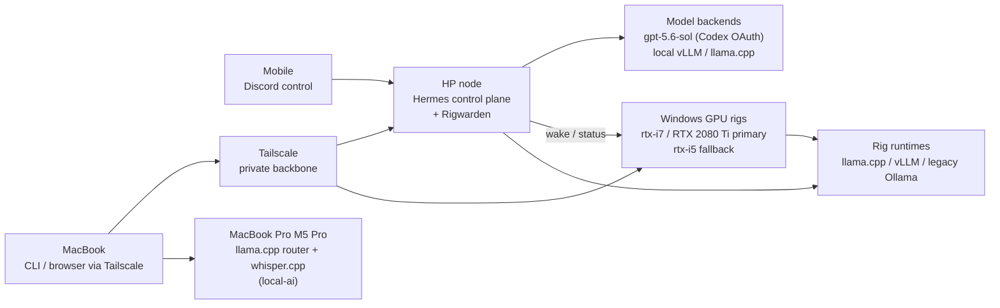

# Homelab

Living documentation of my homelab: AI control planes, private networking, and local GPU and Apple Silicon compute. The setup is kept cost-conscious where possible, using free tiers, self-hosting, open-source tools, and owned hardware instead of paid services when reliability or control matters.

## Snapshot

Hermes is the AI Lab control plane for Discord-first operation, scheduled work, Kanban-style coordination, and local tooling access, with `gpt-5.6-sol` through Codex OAuth as its default model. OpenClaw, which had already been moved off the active path after repeated upgrade fragility, was retired in 2026-10 together with the extra frontier-model routes around it, leaving one control plane. Local vLLM / `llama.cpp` runtimes cover private GPU experiments.

Tailscale is the private backbone. Full lab operation happens from a MacBook over Tailscale, while mobile access stays Discord-first for talking to the agents. This keeps deep administration on a proper workstation while still making the agent layer reachable while traveling.

Local hardware does the inference. The Windows-rebuilt `rtx-i7` / RTX 2080 Ti rig is the primary local GPU path, moving from Ollama-first hosting toward CUDA-backed `llama.cpp` for larger GGUF models; `rtx-i5` remains fallback lab capacity; and Rigwarden, now running on the HP node under Hermes control, wakes the rigs and reports their status. The MacBook Pro (M5 Pro, 48 GB) adds Apple Silicon inference for 27B-class models at long context plus whisper.cpp speech-to-text ([`../local-ai/`](../local-ai/)). The OCI Always Free Kubernetes cluster and its public demo were retired in 2026-10; their configuration stays in [`../k8s-oci-cluster/`](../k8s-oci-cluster/) as a working reference.

## Operating Model

## What Runs Here

**Agent control**

- **Hermes** — the Discord-connected AI Lab control plane, using Kanban coordination, cron jobs, and direct local tooling access; default model `gpt-5.6-sol` through Codex OAuth.

**Infrastructure**

- **HP Docker host** — dedicated home node for Hermes, Rigwarden, automation, and support services.
- **Tailscale** — private network backbone for remote operation without exposing internal services publicly.

**Local compute**

- **rtx-i7** — primary private GPU inference rig with RTX 2080 Ti, rebuilt as a Windows 11 + Docker Desktop GPU host.
- **rtx-i5** — fallback private GPU inference rig with GTX 1080, also rebuilt as a Windows 11 + Docker Desktop GPU host.
- **MacBook Pro M5 Pro (48 GB)** — Apple Silicon inference with PrismML's `llama.cpp` fork in router mode (Ternary Bonsai 2 27B, Qwen3.8 27B, Bielik 11B, all localhost-only) and whisper.cpp speech-to-text; documented in [`../local-ai/`](../local-ai/).
- **Local vLLM / `llama.cpp` / legacy Ollama** — self-hosted model runtimes on the GPU rigs. vLLM is enabled as a general local inference path, while the RTX 2080 Ti path also uses CUDA `llama.cpp` for larger GGUF models such as Qwen3.6-35B-A3B with partial GPU offload, including an MTP-enabled Q4 profile for higher decode throughput. Ollama remains useful for smaller models and compatibility.

## Lab Apps

- **Rigwarden** provides GPU rig wake/status control: UI for the operator, API for agents. It moved from the Raspberry Pi controller to the HP node in 2026-10, where Hermes drives it. 
  

- **Speech-to-text** — whisper.cpp with Whisper large-v3-turbo and Silero VAD on the MacBook turns YouTube videos and local media into transcripts and subtitles ([`../local-ai/whisper/`](../local-ai/whisper/)). It replaced the custom Vidscribe service.

## Retired

Kept here as history; each retirement is logged in the changelog.

| what | retired | why / replaced by |
|---|---|---|
| OCI Always Free Kubernetes cluster | 2026-10 | Torn down. Terraform + Argo CD config kept in [`../k8s-oci-cluster/`](../k8s-oci-cluster/) as a working reference. |
| Kubernetes Manifest Reviewer (public demo) | 2026-10 | Went offline with the cluster. Code in [`maslankalm/k8s-manifest-reviewer`](https://github.com/maslankalm/k8s-manifest-reviewer). |
| `ollama-router` (in-cluster gateway) | 2026-10 | Retired with the cluster. Code in [`maslankalm/ollama-router`](https://github.com/maslankalm/ollama-router). |
| OpenClaw | 2026-10 | Repeated upgrade fragility; Hermes is the single control plane. |
| `opus-expert` (Claude advisory endpoint) | 2026-10 | Was wired into OpenClaw; retired with it. |
| SearXNG | 2026-10 | Retired with the OpenClaw stack. |
| Hermes proxy (SuperGrok / xAI OAuth endpoint) | 2026-10 | Second frontier-model path no longer used; Hermes runs on `gpt-5.6-sol`. |
| Vidscribe | 2026-10 | Replaced by open-source whisper.cpp in [`../local-ai/whisper/`](../local-ai/whisper/) — less complex than a custom service. |

## Changelog

Every homelab change across the cluster, local hardware, networking, and AI control plane is logged in [`CHANGELOG.md`](CHANGELOG.md).
