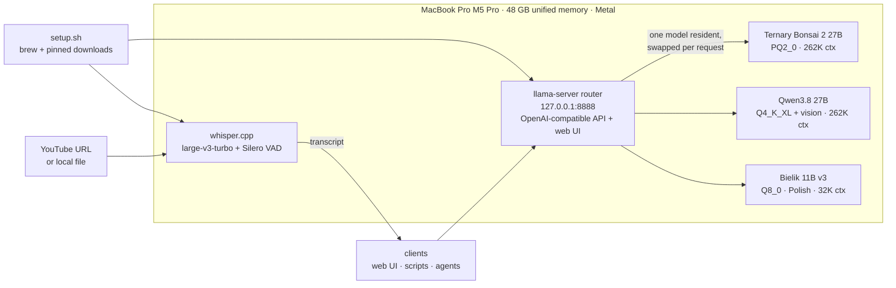

# Local AI on Apple Silicon

Private, local inference on a MacBook Pro (M5 Pro, 48 GB unified memory): **one
OpenAI-compatible endpoint serving three GGUF models** through PrismML's llama.cpp fork in
router mode, plus **whisper.cpp speech-to-text** for YouTube and local media. Everything is
rebuilt from Homebrew by one idempotent script, and every binary and model is pinned and
hash-checked.

It complements the [homelab](../homelab/) GPU rigs: the RTX 2080 Ti runs CUDA llama.cpp
with partial offload, while 48 GB of unified memory holds a whole 27B model *and* a 262K
context on the GPU.

## What This Shows

- **Running a ternary 27B model** — [Ternary Bonsai 2 27B](https://huggingface.co/prism-ml/Ternary-Bonsai-2-27B-gguf)
  needs PrismML's llama.cpp fork (custom tensor types and kernels); it decodes **~1.7x
  faster** than the Q4 Qwen3.8 it was derived from, at full 262K context in 16.6 GiB.
- **Measured, not assumed** — interleaved benchmark rounds to cancel thermal drift on a
  laptop, and a 15-task quality eval with code-computed ground truths and sandboxed code
  execution: **Bonsai 30/30 vs Qwen 29/30**. Rejected options are documented with numbers
  (MTP speculative decoding 1.10x, MLX build 0.87x).
- **Supply-chain-aware setup** — the runtime tarball matches GitHub's published digest;
  models are pinned to Hugging Face *commits* and verified against their LFS SHA256;
  `setup.sh` checks every component and only fetches what's missing.
- **One endpoint, many models** — llama.cpp's router mode: per-model presets in an INI
  file, one model resident at a time, idle models put to sleep (15.75 → 0.8 GiB).
- **Speech-to-text with an honest scorer** — Whisper large-v3-turbo + Silero VAD scored
  against *human* captions: **1.4–1.7% WER on English**, better than YouTube's own
  auto-captions; VAD eliminated Whisper's invented intro text.

## Architecture



## Quick start

On an Apple Silicon Mac with Homebrew (~40 GB of disk for all models):

```sh
cd local-ai
./setup.sh                    # everything: runtime, bonsai + qwen + bielik, whisper
./setup.sh bonsai             # or just the LLMs you name (bonsai | qwen | bielik)

llama-cpp-prism/run.sh        # router + web UI on http://127.0.0.1:8888
whisper/transcribe.sh "https://www.youtube.com/watch?v=..."   # -> whisper/transcripts/<id>/turbo.txt
```

```sh
curl -s http://127.0.0.1:8888/v1/chat/completions \
  -H "Authorization: Bearer $(cat llama-cpp-prism/secrets/api-key.txt)" \
  -H 'Content-Type: application/json' \
  -d '{"model": "bonsai2-27b", "messages": [{"role": "user", "content": "Explain idempotency in one paragraph."}]}'
```

Created locally and gitignored: `models/`, `bin/`, `secrets/` (the API key, mode 0600),
`logs/`, `whisper/transcripts/`.

## Results at a glance

| | Qwen3.8 27B Q4 | Bonsai 2 27B ternary |
|---|---|---|
| file size | 17.6 GB | **7.2 GB** |
| memory at 262K context | 25.3 GiB | **16.6 GiB** |
| decode speed | 12–14 tok/s | **20–23 tok/s** |
| prefill @8K | ~260 tok/s | ~270 tok/s |
| quality eval (15 tasks × 2) | 29/30 | 30/30 |
| median time per task | 66 s | **35 s** |

| speech-to-text (whisper.cpp, Metal) | |
|---|---|
| speed | 33–46x real time (86 min of audio in 2.7 min) |
| English WER vs human captions | **1.4% / 1.7%** (YouTube auto-captions: 3.2% / 2.3%) |

## Layout

| path | what |
|---|---|
| [`setup.sh`](setup.sh) | end-to-end install on a Mac with only Homebrew; safe to re-run |
| [`llama-cpp-prism/`](llama-cpp-prism/) | the router: runtime + model installers, presets, speed benchmark, quality eval and its report |
| [`whisper/`](whisper/) | transcription script, model installer, WER eval against human captions |
